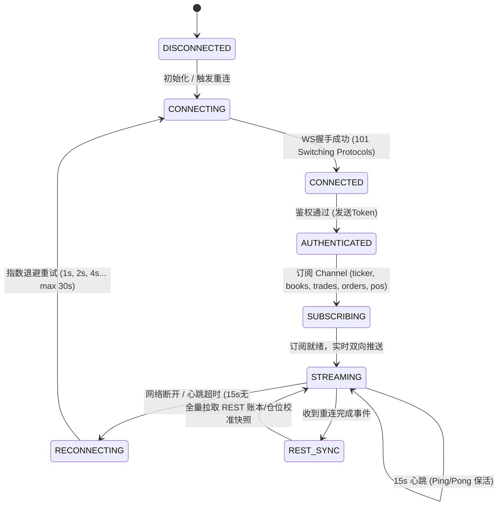

# OKX-Dog 前端交易控制台架构设计与技术规范

## 1. 架构总览与技术栈选型

### 1.1 系统定位与设计哲学
**OKX-Dog 前端交易控制台 (`okx-dog-frontend`)** 是一款面向个人量化操盘手与专业交易员的高性能、极低延迟、金融级暗黑（Sleek Dark Theme）Web 交易副驾驶终端。
前端系统遵循以下核心工程原则：
1. **60 FPS 极速渲染与零卡顿 (Zero Jitter)**：采用 Canvas 原生加速渲染 K 线与技术指标，高频订单簿采用 `requestAnimationFrame` (RAF) 节流缓冲池与虚拟滚动（Virtual Scroll），彻底杜绝密集数据推送下的 UI 掉帧与重排风暴。
2. **毫秒级状态流与精准切片 (State Slicing)**：基于 Zustand 状态机对 WebSocket 行情/订单/仓位/风控事件与 SSE AI 推理流进行分流解耦，结合局部 Selector 订阅，杜绝全量状态变更引发的全局重渲染。
3. **金融级强类型安全 (Strict Type Contracts)**：基于 TypeScript 5.x 实现对后端 REST API、WebSocket 推送以及 AI 结构化 JSON Schema 的 100% 强类型全链路对齐与编译期校验。
4. **极致人机协同体验 (Human-in-the-Loop)**：将 AI 推理思维链、推荐入场区间、多周期支撑阻力位与实时图表深度叠加，支持一键采纳填充与双重确认安全下单。

---

### 1.2 技术栈全景 (Tech Stack)

| 领域 | 选型组件 / 库 | 版本 | 核心用途与优势 |
| :--- | :--- | :--- | :--- |
| **基础框架** | **React** | `^18.3.1` | 支持 Concurrent Mode、`useTransition` 与 `useDeferredValue`，保障高频交互下的输入响应优先级 |
| **构建工具** | **Vite** | `^5.4.0` | 毫秒级 HMR 热重载，基于 Rollup 的极致代码分割与 Tree-shaking 生产构建 |
| **类型系统** | **TypeScript** | `^5.5.4` | 生产级全量类型安全保障，严格模式 (`strict: true`) |
| **状态管理** | **Zustand** | `^4.5.5` | 超轻量级状态容器，支持状态切片（Slices Pattern）与无中间件直接集成 WS 事件驱动 |
| **专业图表** | **Lightweight Charts** | `^4.2.1` | TradingView 官方轻量金融图表引擎，基于 HTML5 Canvas，提供原生 60 FPS 多周期 K 线与自定义 Overlay 绘制 |
| **样式与主题** | **TailwindCSS** + **PostCSS** | `^3.4.10` | 极速原子化 CSS，深度定制金融级暗黑 Design Tokens 与毛玻璃拟态效果 |
| **UI 原语** | **Radix UI Primitives** | `^1.1.0` | 无样式、高无障碍性 (WAI-ARIA) 下拉菜单、弹窗、Tabs、Tooltip 与 Slider 底层 |
| **虚拟滚动** | **@tanstack/react-virtual** | `^3.10.7` | 深度盘口与高频成交历史虚拟化滚动，仅渲染可视区域 DOM 节点 |
| **网络通信** | **Axios** + **原生 WebSocket** + **EventSource** | - | REST 请求拦截（自动注入 Token 与签名防重放）、WS 断线自愈网关、SSE 流式打字机传输 |
| **图标体系** | **Lucide React** | `^0.439.0` | 统一、严谨的金融科技线性矢量图标库 |

---

### 1.3 前端系统分层架构图 (System Architecture)

```mermaid
graph TB
    subgraph ViewLayer [表现层: UI & Layout]
        Header[顶部导航栏: 资产概览 / 行情摘要 / Panic Button]
        ChartPanel[专业K线图表区: Lightweight Charts + 自定义 Overlay]
        OrderBookPanel[盘口深度与成交流: Virtual Scroll + 动态色阶]
        TradePanel[交易下单中枢: 现货/合约 + 杠杆 + 附带止盈止损]
        AIPilotCard[AI 智能副驾驶: CoT 思维链 + 推荐区间 + 一键采纳]
        BottomDrawer[底部多标签面板: 持仓监控 / 挂单列表 / 审计日志 / AI归因]
    end

    subgraph StateLayer [状态域与切片层: Zustand Slices]
        MarketSlice[MarketSlice: 行情/K线/指标/OI/费率]
        TradeSlice[TradeSlice: 下单表单/活动委托/撤单]
        PositionSlice[PositionSlice: 实时持仓/未实现盈亏/强平预警]
        RiskSlice[RiskSlice: 硬风控配置/日累计亏损/熔断锁]
        AISlice[AISlice: AI研判/思维链流/置信度/一键采纳]
        SystemSlice[SystemSlice: 凭证状态/网络延迟/Panic状态/Toast]
    end

    subgraph EngineLayer [引擎与流控层: Engine & Streaming Hub]
        RAFHub[RAF 帧率缓冲池: 60 FPS Throttle & Delta Merge]
        OverlayEngine[图表标注叠加引擎: 均价线/TP/SL/AI支撑阻力]
        AudioEngine[金融级音效反馈: 订单成交/风控拦截/紧急熔断]
        Virtualizer[TanStack Virtual DOM 渲染引擎]
    end

    subgraph TransportLayer [传输与协议层: Transport Layer]
        WSGateway[WebSocket 客户端: 心跳守护 + 断线自愈 + 订阅分发]
        SSEReceiver[SSE 流式接收器: AI 流式推理解析器]
        RestClient[REST API Client: Axios + 错误拦截 + 重放保护]
    end

    ViewLayer --> StateLayer
    StateLayer --> EngineLayer
    EngineLayer --> TransportLayer
```



---

## 2. 金融级暗黑专业交易主题 (Design Tokens)

### 2.1 颜色系统规范 (Color Palette Hierarchy)
OKX-Dog 采用专为长时间盯盘设计的**深度冷灰与午夜黑层级递进体系**，辅以 OKX / Binance 行业标准的涨绿跌红高对比度指示色与 AI 科技霓虹强调色：

```
+-----------------------------------------------------------------------------------+
| 背景层级 (Background Layers)                                                     |
|  - 最底层画布 (Canvas Base):    #07090E (极深黑，降低整体光污染)                     |
|  - 主容器背景 (Container Base): #0B0E14 (微透灰黑，主工作区)                         |
|  - 面板/卡片背景 (Panel/Card):   #121721 (深蓝灰，承载主要内容)                       |
|  - 悬浮/激活背景 (Hover/Active): #1A2230 (轻度高亮，交互响应)                         |
|  - 弹窗/抽屉背景 (Modal/Drawer): #161D2B (毛玻璃基底，搭配 backdrop-blur-md)         |
+-----------------------------------------------------------------------------------+
| 边框与分割线 (Borders & Dividers)                                                 |
|  - 默认边框 (Border Default):   #1E293B (Tailwind slate-800)                      |
|  - 高亮边框 (Border Highlight): #334155 (焦点与选中状态)                             |
|  - 危险边框 (Border Danger):    #EF4444 (风控拦截与报警边界)                         |
+-----------------------------------------------------------------------------------+
| 文本与排版层级 (Typography Colors)                                                |
|  - 主要文字 (Text Primary):     #F8FAFC (纯净亮白，用于最新价、核心标题)              |
|  - 次要文字 (Text Secondary):   #94A3B8 (中性浅灰，用于标签、表头)                    |
|  - 弱化文字 (Text Muted):       #64748B (深冷灰，用于时间戳、次要单位)                |
+-----------------------------------------------------------------------------------+
| 金融多空交易语义色 (Market Semantics)                                             |
|  - 上涨/买入/多头 (Bullish/Buy):  #00C087 (OKX翡翠绿), 背景淡色: #00C0871A (10% 不透明) |
|  - 下跌/卖出/空头 (Bearish/Sell): #FF3B69 (OKX霓虹红), 背景淡色: #FF3B691A (10% 不透明) |
|  - 警告/强平风险 (Warning):       #F59E0B (琥珀金),   背景淡色: #F59E0B1A           |
+-----------------------------------------------------------------------------------+
| AI 与高阶特征色 (AI & Accents)                                                    |
|  - AI 科技紫 (AI Intelligence): #6366F1 (Indigo-500, 思维链与主研判卡片)             |
|  - 电光蓝 (Electric Cyan):      #38BDF8 (Sky-400, 关键支撑阻力与指标高亮)            |
+-----------------------------------------------------------------------------------+
```

### 2.2 TailwindCSS 配置文件集成 (`tailwind.config.js`)

```javascript
/** @type {import('tailwindcss').Config} */
export default {
  darkMode: 'class',
  content: ['./index.html', './src/**/*.{js,ts,jsx,tsx}'],
  theme: {
    extend: {
      colors: {
        bg: {
          canvas: '#07090E',
          base: '#0B0E14',
          panel: '#121721',
          hover: '#1A2230',
          modal: '#161D2B',
        },
        border: {
          subtle: '#1E293B',
          prominent: '#334155',
          danger: '#EF4444',
          success: '#00C087',
        },
        trade: {
          buy: '#00C087',
          'buy-dim': 'rgba(0, 192, 135, 0.12)',
          'buy-glow': 'rgba(0, 192, 135, 0.35)',
          sell: '#FF3B69',
          'sell-dim': 'rgba(255, 59, 105, 0.12)',
          'sell-glow': 'rgba(255, 59, 105, 0.35)',
        },
        ai: {
          purple: '#6366F1',
          'purple-dim': 'rgba(99, 102, 241, 0.15)',
          cyan: '#38BDF8',
          'cyan-dim': 'rgba(56, 189, 248, 0.15)',
        },
      },
      fontFamily: {
        sans: ['Inter', 'system-ui', 'sans-serif'],
        mono: ['"JetBrains Mono"', '"Roboto Mono"', 'monospace'],
      },
      animation: {
        'pulse-fast': 'pulse 1s cubic-bezier(0.4, 0, 0.6, 1) infinite',
        'flash-green': 'flashGreen 0.4s ease-out',
        'flash-red': 'flashRed 0.4s ease-out',
      },
      keyframes: {
        flashGreen: {
          '0%': { backgroundColor: 'rgba(0, 192, 135, 0.4)' },
          '100%': { backgroundColor: 'transparent' },
        },
        flashRed: {
          '0%': { backgroundColor: 'rgba(255, 59, 105, 0.4)' },
          '100%': { backgroundColor: 'transparent' },
        },
      },
    },
  },
  plugins: [],
};
```

---

## 3. WebSocket / SSE 毫秒级状态流与 Zustand 状态切片

### 3.1 网络传输架构与断线自愈状态机



### 3.2 Zustand 状态切片分工 (State Slicing Architecture)

整个前端状态中心由 6 大专属 Slice 聚合而成，每个 Slice 各司其职，保证单向数据流与高性能选择性重渲染：

```
                    ┌─────────────────────────┐
                    │      useAppStore        │
                    └────────────┬────────────┘
         ┌───────────────┬───────┴───────┬───────────────┐
         ▼               ▼               ▼               ▼
  ┌──────────────┐┌──────────────┐┌──────────────┐┌──────────────┐
  │ MarketSlice  ││  TradeSlice  ││PositionSlice ││  RiskSlice   │
  │ 行情/K线/指标 ││ 下单/挂单管理 ││ 仓位/盈亏监控 ││ 硬风控/熔断锁 │
  └──────────────┘└──────────────┘└──────────────┘└──────────────┘
         │                                               │
         ├───────────────────────┬───────────────────────┤
         ▼                                               ▼
  ┌──────────────┐                               ┌──────────────┐
  │   AISlice    │                               │ SystemSlice  │
  │ 研判/CoT/模式 │                               │ 凭证/延迟/Toast│
  └──────────────┘                               └──────────────┘
```

1. **`MarketSlice`**:
   - `selectedSymbol`: 当前监控与交易的主标的（如 `'BTC-USDT-SWAP'`）。
   - `activeTimeframe`: 当前 K 线主周期（`'15m' | '1h' | '4h' | '1d'`）。
   - `tickers`: 全量币种 24h 价格、涨跌幅、成交量、资金费率与下次结算倒计时。
   - `orderbook`: 实时盘口深度（买卖各 20 档），带累计数量与深度百分比计算。
   - `recentTrades`: 最近 50 条逐笔成交流。
   - `derivatives`: 全网持仓量 (OI)、多空持仓比与大户持仓异动。
   - `indicators`: 多周期计算后的 EMA(20/50/200)、MACD、RSI、布林带与 ATR 指标。

2. **`TradeSlice`**:
   - `orderForm`: 下单输入态（现货/合约、方向、委托类型、委托价、委托数量、杠杆倍数、止盈止损设定）。
   - `openOrders`: 当前活跃挂单列表（未成交/部分成交）。
   - `orderHistory`: 历史委托与成交明细。
   - `isSubmitting`: 下单防重提交状态锁。

3. **`PositionSlice`**:
   - `positions`: 活跃持仓全景（标的、方向、开仓均价、标记价、强平价、未实现盈亏、保证金率）。
   - `accountBalance`: 账户总资产估值（折合 USDT / BTC）、可用余额、冻结资金、当日总收益。
   - `isLiquidationWarning`: 保证金率触及警戒线（如 < 15%）的全局高危告警。

4. **`RiskSlice`**:
   - `limits`: 后端硬风控规则快照（单笔限额、单日亏损熔断线、杠杆硬锁上限、滑点阈值）。
   - `isCircuitBroken`: 是否进入熔断锁死状态（单日亏损触顶或人工 Panic）。
   - `circuitBreakReason`: 熔断原因说明。
   - `dailyLossCurrent`: 当日已实现+未实现亏损总额。
   - `riskAuditLogs`: 拦截与告警事件流。

5. **`AISlice`**:
   - `copilotMode`: 人机协同模式（`MANUAL` 手动一键采纳 / `SEMI_AUTO` 半自动提醒 / `AUTO_PILOT` 小额全自动）。
   - `latestAnalysis`: 当前标的最新 AI 结构化研判对象（严格符合 `AI_SCHEMA.json`）。
   - `isAnalyzing`: AI 研判请求在途状态。
   - `cotStreamContent`: 推理模型（如 DeepSeek-R1）流式输出的 `<think>` 思维链实时内容。
   - `adoptAnalysisToForm()`: 将 AI 推荐的点位与止盈止损一键注入 `TradeSlice.orderForm` 的动作方法。

6. **`SystemSlice`**:
   - `credentialsStatus`: OKX 凭证脱敏与有效性状态、LLM 配置状态。
   - `networkLatency`: WebSocket 心跳 RTT 延迟（毫秒）与健康状态。
   - `panicState`: 全局紧急熔断状态机。
   - `toasts`: 全局轻量通知与硬风控阻断提示队列。

---

## 4. TradingView / Lightweight Charts 图表渲染与自定义 Overlay 架构

### 4.1 图表分层与 Overlay 叠加机制

TradingView Lightweight Charts 基于 HTML5 Canvas 执行硬件加速绘制。为了将**量化交易员核心关切要素**（持仓均价、止盈止损、AI 预测区间、压力支撑位）直观呈现，前端设计了分层 Overlay 渲染流水线：

```
+-----------------------------------------------------------------------------------+
| Lightweight Charts Canvas 渲染分层                                                |
|                                                                                   |
| Layer 4 (Top):    AI 研判建议水平线 & 支撑阻力虚线 (S1/S2: 绿色, R1/R2: 红色)        |
| Layer 3:          活动委托挂单价格线 (Limit Orders Price Lines)                     |
| Layer 2:          持仓均价线 (Position Avg Price Line) & TP/SL 止盈止损动态线        |
| Layer 1:          技术指标叠加图 (EMA 20/50/200 曲线, 布林带上下轨区域)             |
| Layer 0 (Base):   多周期 K 线蜡烛图序列 (Candlestick Series) & 成交量柱状图          |
+-----------------------------------------------------------------------------------+
```

### 4.2 核心 Overlay 实现逻辑与代码架构

```typescript
import { 
  createChart, 
  IChartApi, 
  ISeriesApi, 
  CandlestickData, 
  LineStyle, 
  IPriceLine 
} from 'lightweight-charts';
import { PositionItem, AIAnalysisResponse } from './TYPES_CONTRACT';

export class ChartOverlayManager {
  private chart: IChartApi;
  private candleSeries: ISeriesApi<'Candlestick'>;
  private positionAvgLine: IPriceLine | null = null;
  private takeProfitLine: IPriceLine | null = null;
  private stopLossLine: IPriceLine | null = null;
  private aiKeyLevelLines: IPriceLine[] = [];

  constructor(chart: IChartApi, candleSeries: ISeriesApi<'Candlestick'>) {
    this.chart = chart;
    this.candleSeries = candleSeries;
  }

  /**
   * 渲染/更新持仓均价线与关联止损止盈虚线
   */
  public updatePositionOverlays(position?: PositionItem | null) {
    // 1. 清理现有持仓线
    if (this.positionAvgLine) {
      this.candleSeries.removePriceLine(this.positionAvgLine);
      this.positionAvgLine = null;
    }
    if (this.takeProfitLine) {
      this.candleSeries.removePriceLine(this.takeProfitLine);
      this.takeProfitLine = null;
    }
    if (this.stopLossLine) {
      this.candleSeries.removePriceLine(this.stopLossLine);
      this.stopLossLine = null;
    }

    if (!position || position.pos_size <= 0) return;

    // 2. 绘制持仓均价线 (黄色高亮实线)
    const isLong = position.pos_side === 'long';
    this.positionAvgLine = this.candleSeries.createPriceLine({
      price: position.avg_price,
      color: isLong ? '#38BDF8' : '#F59E0B',
      lineWidth: 2,
      lineStyle: LineStyle.Solid,
      axisLabelVisible: true,
      title: `持仓均价 (${position.pos_side.toUpperCase()} ${position.pos_size}张)`,
    });

    // 3. 绘制止盈线 (绿色短虚线)
    if (position.tp_trigger_price && position.tp_trigger_price > 0) {
      this.takeProfitLine = this.candleSeries.createPriceLine({
        price: position.tp_trigger_price,
        color: '#00C087',
        lineWidth: 1,
        lineStyle: LineStyle.Dashed,
        axisLabelVisible: true,
        title: 'TP (止盈触发)',
      });
    }

    // 4. 绘制止损线 (红色长虚线)
    if (position.sl_trigger_price && position.sl_trigger_price > 0) {
      this.stopLossLine = this.candleSeries.createPriceLine({
        price: position.sl_trigger_price,
        color: '#FF3B69',
        lineWidth: 1,
        lineStyle: LineStyle.LargeDashed,
        axisLabelVisible: true,
        title: 'SL (止损触发)',
      });
    }
  }

  /**
   * 渲染 AI 结构化研判给出的支撑/阻力位与建议交易区间
   */
  public updateAIAnalysisOverlays(analysis?: AIAnalysisResponse | null) {
    // 1. 清理上一轮 AI 标注线
    this.aiKeyLevelLines.forEach(line => this.candleSeries.removePriceLine(line));
    this.aiKeyLevelLines = [];

    if (!analysis) return;

    // 2. 绘制支撑位 S1 / S2 (亮绿色虚线)
    if (analysis.timeframe_analysis?.tf_1h?.support_level) {
      const s1 = this.candleSeries.createPriceLine({
        price: analysis.timeframe_analysis.tf_1h.support_level,
        color: 'rgba(0, 192, 135, 0.8)',
        lineWidth: 1,
        lineStyle: LineStyle.Dotted,
        axisLabelVisible: true,
        title: 'AI 支撑 S1 (1h)',
      });
      this.aiKeyLevelLines.push(s1);
    }

    // 3. 绘制阻力位 R1 / R2 (霓虹红虚线)
    if (analysis.timeframe_analysis?.tf_1h?.resistance_level) {
      const r1 = this.candleSeries.createPriceLine({
        price: analysis.timeframe_analysis.tf_1h.resistance_level,
        color: 'rgba(255, 59, 105, 0.8)',
        lineWidth: 1,
        lineStyle: LineStyle.Dotted,
        axisLabelVisible: true,
        title: 'AI 阻力 R1 (1h)',
      });
      this.aiKeyLevelLines.push(r1);
    }

    // 4. 绘制 AI 交易计划的止损线与止盈目标
    if (analysis.trade_plan) {
      if (analysis.trade_plan.stop_loss_price > 0) {
        const aiSl = this.candleSeries.createPriceLine({
          price: analysis.trade_plan.stop_loss_price,
          color: '#FF3B69',
          lineWidth: 2,
          lineStyle: LineStyle.Dashed,
          axisLabelVisible: true,
          title: `AI 建议止损 [${analysis.signal.action}]`,
        });
        this.aiKeyLevelLines.push(aiSl);
      }
      
      analysis.trade_plan.take_profit_levels.forEach((tp, idx) => {
        const aiTp = this.candleSeries.createPriceLine({
          price: tp.price,
          color: '#00C087',
          lineWidth: 1,
          lineStyle: LineStyle.Dashed,
          axisLabelVisible: true,
          title: `AI 止盈目标 ${idx + 1} (${Math.round(tp.percentage * 100)}%)`,
        });
        this.aiKeyLevelLines.push(aiTp);
      });
    }
  }

  /**
   * 销毁所有 Overlays 释放内存
   */
  public destroy() {
    this.updatePositionOverlays(null);
    this.updateAIAnalysisOverlays(null);
  }
}
```

---

## 5. 高频订单簿与实时成交流 60 FPS 性能保障策略

### 5.1 高频行情渲染痛点与防抖合并（RAF Throttle）
在行情剧烈波动时，OKX WebSocket 每秒可能推送数十次深度与逐笔成交更新。若每次推送都直接触发 React 的 `setState`，会导致：
1. **主线程长时间阻塞 (Long Tasks > 50ms)**；
2. **React Fiber 树频繁进行 Reconciliation，导致严重丢帧（< 30 FPS）**；
3. **用户在下单面板中的输入与点击产生明显滞后**。

### 5.2 解决方案：基于 `requestAnimationFrame` 的缓冲池机制

```
WebSocket 推送流 (50+ msgs/sec)
        │
        ▼
┌─────────────────────────────────────────┐
│       OrderBook Buffer Pool (内存缓冲)   │
│   - 实时合并增量 (Delta Update)         │
│   - 重算 20 档累计深度与价格梯度          │
└───────────────────┬─────────────────────┘
                    │
                    ▼  每 16.6ms (60 FPS) 触发一次
┌─────────────────────────────────────────┐
│     RAF Dispatcher (requestAnimationFrame)│
│   - 取消未执行的旧帧请求                 │
│   - 单次提交最新快照至 Zustand / DOM     │
└───────────────────┬─────────────────────┘
                    │
                    ▼
┌─────────────────────────────────────────┐
│      TanStack Virtualized DOM 节点      │
│   - 仅挂载屏幕内 20 行 DOM              │
│   - CSS transform: scaleX 绘制深度背景  │
└─────────────────────────────────────────┘
```

### 5.3 生产级 RAF 节流器实现代码

```typescript
export class RAFOrderbookThrottler<T> {
  private pendingData: T | null = null;
  private rafId: number | null = null;
  private callback: (data: T) => void;

  constructor(callback: (data: T) => void) {
    this.callback = callback;
  }

  /**
   * 接收高频增量数据并缓存，调度下一帧执行
   */
  public push(data: T) {
    this.pendingData = data;
    if (this.rafId === null) {
      this.rafId = requestAnimationFrame(() => {
        if (this.pendingData !== null) {
          this.callback(this.pendingData);
          this.pendingData = null;
        }
        this.rafId = null;
      });
    }
  }

  /**
   * 清理未完成的帧动画，防止内存泄漏
   */
  public dispose() {
    if (this.rafId !== null) {
      cancelAnimationFrame(this.rafId);
      this.rafId = null;
    }
    this.pendingData = null;
  }
}
```

### 5.4 深度背景条与闪烁动效的 GPU 加速优化
- **背景深度条**：使用绝对定位的 `div` 元素，宽度通过 `style={{ transform: `scaleX(${depthRatio})`, transformOrigin: 'right' }}` 动态设置，启用 GPU 硬件加速合成层（Compositor Layer），彻底避免触发浏览器的重排（Reflow）。
- **成交变动闪烁**：通过给变动的价格行添加短暂的 CSS 类名（`.animate-flash-green` / `.animate-flash-red`），动画结束后由 CSS 自动淡出，避免在 React 状态树中维护高频闪烁定时器。

---

## 6. 模块组织与目录结构规范

```
okx-dog-frontend/
├── public/                     # 静态资源、Logo 与音效文件 (alarm.mp3, fill.mp3)
├── src/
│   ├── api/                    # REST API 请求封装与 SSE 流式连接器
│   │   ├── client.ts           # Axios 统一客户端与拦截器
│   │   ├── tradeApi.ts         # 下单/撤单/持仓/风控 REST 接口
│   │   └── sseClient.ts        # AI 思维链与流式研判接收器
│   ├── assets/                 # 样式表与全局字体
│   │   └── index.css           # Tailwind 指令与金融等宽字体定义
│   ├── components/             # 通用与专业业务 UI 组件
│   │   ├── common/             # Button, Input, Modal, Badge, Toast, Tooltip
│   │   ├── layout/             # Header, Navigation, StatusBar, DockableGrid
│   │   ├── chart/              # LightweightChartContainer, TimeframeSelector, ChartOverlays
│   │   ├── orderbook/          # OrderBookTable, VirtualDepthList, TradeStream
│   │   ├── trade/              # TradePanel, OrderForm, LeverageSlider, TPSLConfig
│   │   ├── ai/                 # AICopilotCard, ThinkingProcessDrawer, AdoptConfirmModal
│   │   └── positions/          # PositionTable, OpenOrdersTable, RiskAuditTable
│   ├── hooks/                  # 自定义 React Hooks
│   │   ├── useWebSocket.ts     # WS 连接生命周期与频道订阅 Hook
│   │   ├── useChart.ts         # Lightweight Charts 实例化与多周期同步 Hook
│   │   └── useKeyboardShortcuts.ts # 专业交易员快捷键（如 Esc全撤、Space聚焦下单）
│   ├── store/                  # Zustand 状态中心与切片
│   │   ├── index.ts            # 根 Store 导出与中间件配置
│   │   ├── marketSlice.ts      # 行情/深度/成交流切片
│   │   ├── tradeSlice.ts       # 交易/活动委托切片
│   │   ├── positionSlice.ts    # 资产/持仓切片
│   │   ├── riskSlice.ts        # 硬风控与熔断切片
│   │   ├── aiSlice.ts          # AI 决策与思维链切片
│   │   └── systemSlice.ts      # 系统凭证/网络/Panic 切片
│   ├── types/                  # 全量 TypeScript 类型契约
│   │   └── contracts.ts        # 100% 对齐后端与 AI 的强类型定义
│   ├── utils/                  # 金融计算与格式化工具函数
│   │   ├── formatters.ts       # 价格/数量/百分比高精度格式化
│   │   ├── calculations.ts     # 强平价/保证金率/盈亏比前端计算
│   │   └── sound.ts            # Web Audio API 提示音控制器
│   ├── App.tsx                 # 根组件、全局 Error Boundary 与 Toast 容器
│   └── main.tsx                # 应用启动入口
├── index.html                  # 页面模板与 Google Fonts 预加载
├── package.json                # 依赖包清单
├── tsconfig.json               # TypeScript 严格编译配置
├── vite.config.ts              # Vite 构建配置与 Dev Server 代理
└── tailwind.config.js          # TailwindCSS 金融暗黑主题配置
```

---

## 7. 全景标的检索器与人机协同双卡片架构

### 7.1 全景标的检索器 (`SymbolSelectorModal` / `Ctrl+P`)
为满足交易员在多币种与 TradFi（黄金、白银、美股代币、外汇、RWA）资产间秒级切换的需求：
1. **全局快捷键响应**：`Ctrl + P` / `Cmd + P` 全局监听快速唤起模态框。
2. **四大分类专区**：
   - 💼 **持仓无缝联动**：自动拉取并置顶当前持仓，一键定位目标标的；
   - 🏛️ **TradFi / 大宗 / 美股代币**：`XAU-USDT-SWAP`、`NVDA-USDT-SWAP` 等；
   - 💎 **RWA 链上现实资产**：`ONDO-USDT-SWAP`、`PENDLE` 等；
   - 🚀 **主流加密资产**：`BTC`、`ETH`、`SOL` 等。
3. **自选收藏 (Watchlist)**：本地 `localStorage` 持久化收藏标的。
4. **动态单位与精度格式化 (`symbolHelper.ts`)**：
   - 根据当前激活标的自适应计算数量单位（如 `XAU`、`NVDA`、`ONDO`）与价格显示精度。

### 7.2 人机协同双卡片分工机制
```
┌─────────────────────────────────────────────────────────────┐
│                      人机协同双卡片分工体系                   │
├──────────────────────────────┬──────────────────────────────┤
│ 1. 7x24h 自动化常驻看板      │ 2. 交易员深度副驾驶 (Copilot) │
│ (AutoPilotCard)              │ (AICopilotCard)              │
├──────────────────────────────┼──────────────────────────────┤
│ • 7x24h 后端脱机常驻状态      │ • 主观多周期技术指标深度剖析 │
│ • 多标的轮巡池动态增删配置   │ • DeepSeek/CLI 思维链打字机  │
│ • 组合最大并发持仓上限控制   │ • ⚡ 一键采纳开仓 (市价直通)  │
│ • 动态移动保本 (Breakeven)   │ • ⚙️ 参数微调进阶采纳        │
│ • 后端巡检事件流水与收益走势 │ • 人工干预与策略验证决策     │
└──────────────────────────────┴──────────────────────────────┘
```

---

## 8. v3.5 AI Quant Studio 策略实验室前端架构

### 8.1 模块定位与布局设计
`QuantStudioModal` 作为独立的高阶量化策略工作台：
1. **左侧交互控制面板**：
   - 自然语言 Prompt 需求输入框；
   - 官方经典因子模板切换（自适应布林带、RSI+资金费率动量、双均线+OI持仓量金叉）；
   - 回测标的与周期配置；
   - 黄金基准测试集 (Golden Dataset) 一键评测面板。
2. **右侧工作区与可视化**：
   - 向量化 Python 源码编辑器（支持查看生成代码、语法修改与自定义二次回测）；
   - AST 100% 安全审查合规标识；
   - 回测核心指标卡片（累计收益率、最大回撤、夏普比率、卡尔玛比率、胜率、交易笔数）；
   - SVG 资金权益走势曲线 (Equity Curve) 与关键开平仓时序打点。

### 8.2 状态流转与 API 集成
- `studioApi` 提供 `generateStrategy`, `backtestCustom`, `getTemplates`, `runBenchmark` 强类型接口；
- `useAppStore` 统一管理 `isStudioModalOpen`, `openStudioModal`, `closeStudioModal` 状态。

---

## 9. 架构总结与交付保障

本架构方案完全围绕 **金融级安全、毫秒级低延迟、60 FPS 丝滑交互、TradFi 全景资产联动、7x24h 脱机常驻操盘与 AI Quant Studio 自主研发沙箱** 展开，具备极强的生产落地性与可持续化演进能力。所有数据结构、状态切片与渲染流水线均与后端及 AI 引擎形成严密的契约闭环。

